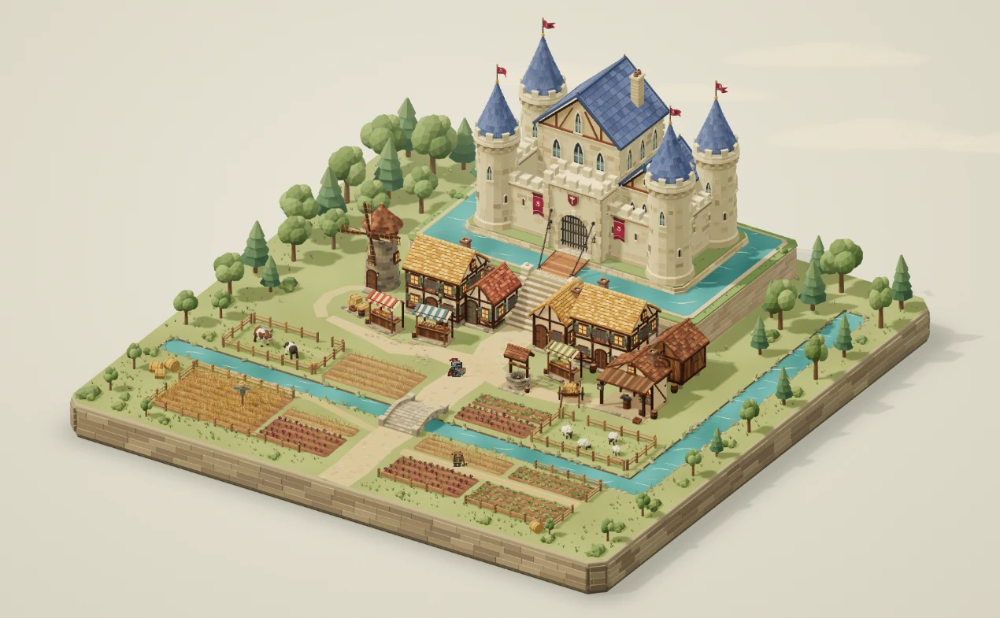

# 蓟丘领 · Thistle Manor

一块石砌底座上的中世纪微缩领地：后方高台是宅堡与护城河，中间是村庄与市集，前方是由灌溉水渠串联的田地与牧场。场景、像素角色及天气特效均由代码生成，不需要下载贴图和模型。



```sh
npm ci
npm run dev
```

打开终端显示的地址。支持 WebGL 2 的现代浏览器可运行。生产构建为 `npm run build`，将 `dist/` 通过静态 HTTP 服务发布；可用 `npm run preview` 本地预览。

- 拖拽环绕，滚轮或双指缩放；键盘聚焦画面后也可用方向键和 `+` / `-`，`Home` 重置视角。
- 默认隐藏天气 UI。按 `W`，或点击右下角的天气按钮区域（鼠标移入或触摸画面后显示按钮），可在晴朗、多云、细雨、晨雾间切换。开启自动轮换后，每 38 秒切换一次。
- 场景遵循系统的减少动态效果设置；开启后，模型动效放缓、步伐不再扬起碎草和落叶。

入口位于 `src/main.js`。地基、宅堡、村庄、农田、角色及天气各自成模块；静态部件按材质合批，植被使用实例化渲染，角色使用低分辨率帧贴图。
